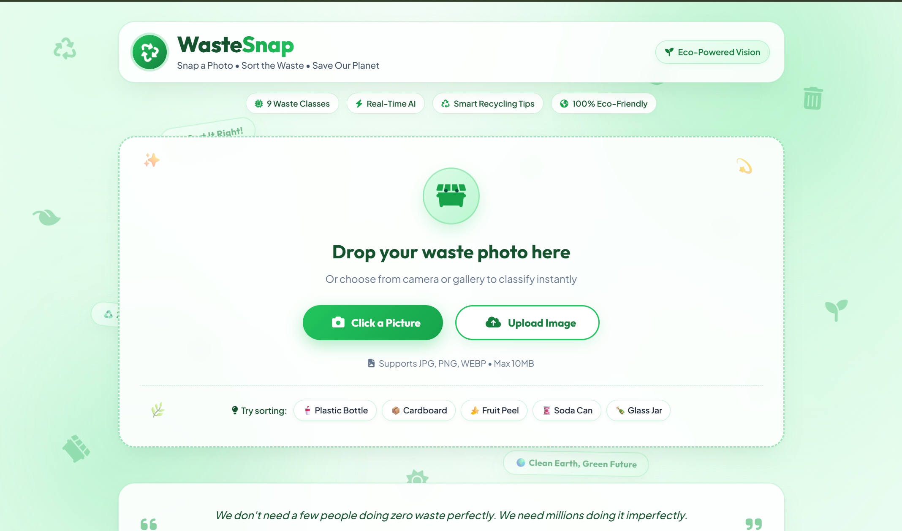

# 🌱 WasteSnap - AI-Powered Waste Classification & Smart Recycling

[](https://www.python.org/)
[](https://flask.palletsprojects.com/)
[](https://www.tensorflow.org/)
[](https://developer.mozilla.org/)
[](LICENSE)

An end-to-end computer vision web application that classifies household and municipal waste into **9 distinct categories in real time**, determining recyclability status and providing smart disposal guidance to combat recycling contamination.

---

## 📸 Interface Preview



---

## ⚡ 30-Second Recruiter Summary

| Item | Details |
| :--- | :--- |
| **Problem Solved** | Over 25% of recyclable waste ends up in landfills due to sorting confusion and recycling contamination. WasteSnap provides instant, automated AI categorization and actionable disposal tips right at the point of disposal. |
| **Core Technology** | **TensorFlow / Keras** convolutional neural network, **Flask REST API**, **Pillow & NumPy** image preprocessing pipeline, modern **Vanilla JS & CSS3** responsive UI. |
| **Inference Scope** | Classifies images into **9 categories**: Plastic, Paper/Cardboard, Glass, Metal, Organic, Electronic, Medicinal, Hazardous, and General Waste. |
| **Key Engineering Highlights** | • Direct browser camera access via **WebRTC MediaDevices API**.<br>• Drag-and-drop file upload with animated feedback.<br>• Clean RESTful architecture (`/predict` endpoint returning category, recyclability flag, confidence score, and custom tips).<br>• Zero heavy frontend framework dependencies for sub-second load times and high accessibility.<br>• Playful, light-themed eco design system with ambient floating background graphics and dynamic micro-animations. |
| **Role & Ownership** | **Solo Developer & ML Engineer** — Architected model integration, API design, preprocessing, and complete frontend UI overhaul. |

---

## 🎯 Key Features

- **Dual Ingestion Channels**: Capture real-time pictures directly through device camera (mobile-friendly environment-facing camera support) or drag-and-drop images (JPG, PNG, WEBP).
- **9 Waste Categories Supported**:
  - 🧴 **Plastic Waste** *(Recyclable)*
  - 📦 **Paper & Cardboard** *(Recyclable)*
  - 🍾 **Glass Waste** *(Recyclable)*
  - 🥫 **Metal Waste** *(Recyclable)*
  - 🍎 **Organic Waste** *(Compostable / Non-recyclable)*
  - 🔋 **Electronic Waste (E-Waste)** *(Special Handling)*
  - 💊 **Medicinal Waste** *(Special Disposal)*
  - ⚠️ **Hazardous Waste** *(Safety Protocol)*
  - 🗑️ **General Waste** *(Landfill / Bagged)*
- **Confidence Metrics & Recyclability Badges**: Visual animated confidence indicators with category-specific emojis and recyclability flags.
- **Smart Disposal Guidelines**: Dynamic checklist of practical, actionable steps for each predicted category (e.g. rinsing cans, separating lids, e-waste drop-off advice).
- **Playful, Modern UI**: Custom light-themed palette with soft eco-green gradients, floating background iconography, interactive dropzone mascot, and inspirational sustainability fact ticker.

---

## 🏗️ System Architecture & Workflow

```
[User Image]
     │
     ▼
[Frontend (Browser)] ──── Drag-and-Drop or Live Camera Capture (WebRTC)
     │
     ▼ (HTTP POST /predict with multipart/form-data)
[Flask REST Server]
     │
     ├─► PIL & NumPy (Resize to 224x224, normalize pixel array to [0, 1], add batch dimension)
     │
     ├─► TensorFlow Model (wastesnap_model.h5) ──► Softmax Output Probability Array
     │
     ├─► Category Mapper & Recyclability / Disposal Guidelines Lookup
     │
     ▼ (JSON Response: { category, recyclability, confidence, tips })
[Interactive Results UI] ──── Animated Confidence Bar + Eco Confetti + Disposal Tips
```

---

## 🛠️ Tech Stack Breakdown

### **Machine Learning & Data Processing**
- **TensorFlow / Keras**: Deep learning framework used for training and loading the convolutional image classification model (`.h5`).
- **NumPy**: Matrix transformations and batch array structuring.
- **Pillow (PIL)**: In-memory image decoding, stream handling, and resizing (`224x224`).

### **Backend & API**
- **Python 3.12**: Core server runtime.
- **Flask**: Lightweight WSGI microframework serving static assets and the `/predict` API route.
- **Flask-CORS**: Cross-Origin Resource Sharing handling.

### **Frontend & UX**
- **HTML5 & Vanilla CSS3**: Modern glassmorphism, responsive CSS grid/flexbox layouts, custom animated floating elements.
- **JavaScript (ES6+)**: Asynchronous `fetch` calls, drag-and-drop event handlers, canvas confetti animation, DOM state updates.
- **FontAwesome 6 & Google Fonts**: Plus Jakarta Sans and Outfit typography.

---

## 📂 Project Directory Structure

```plaintext
WasteSnap/
├── app.py                  # Flask server, image preprocessing & inference endpoint
├── wastesnap_model.h5      # Pre-trained TensorFlow deep learning model
├── requirements.txt        # Python dependency manifest
├── image.png               # Application screenshot for documentation
├── README.md               # Project documentation & recruiter overview
├── templates/
│   └── index.html          # Main application page layout & camera modal
└── static/
    ├── styles.css          # Eco-green design system, responsive styles & animations
    └── script.js           # Client-side capture, drag-and-drop, API integration & confetti
```

---

## 🚀 Quickstart & Local Setup

### 1. Clone the Repository
```bash
git clone https://github.com/Mayank149/WasteSnap.git
cd WasteSnap
```

### 2. Create a Virtual Environment (Recommended)
```bash
# Windows
python -m venv venv
venv\Scripts\activate

# macOS / Linux
python3 -m venv venv
source venv/bin/activate
```

### 3. Install Dependencies
```bash
pip install -r requirements.txt
```

### 4. Run the Application
```bash
python app.py
```

### 5. Access in Browser
Navigate to `http://localhost:5000` (or `http://127.0.0.1:5000`).

---

## 👨‍💻 Author & Contact

**Mayank Bansal**
- GitHub: [@Mayank149](https://github.com/Mayank149)
- Repository: [WasteSnap](https://github.com/Mayank149/WasteSnap)

---

## 📄 License

This project is open-source and distributed under the [MIT License](LICENSE).